# Storyboard — actual complete cut

Every frame below comes from the conformed v2 plates or the two real generated handoffs, with final local action overlays. No missing-source placeholders are shown. See `storyboard_contact.jpg` for the visual sequence.

**OPENING · 2.5s** — A business question invites an evidence-backed investigation.

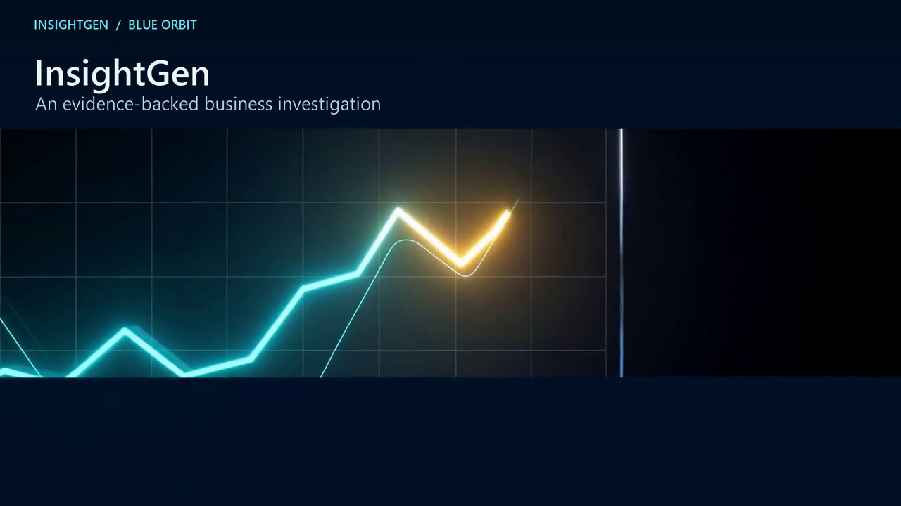

**OPENING · 7s** — Both agenda items are established before the recording.

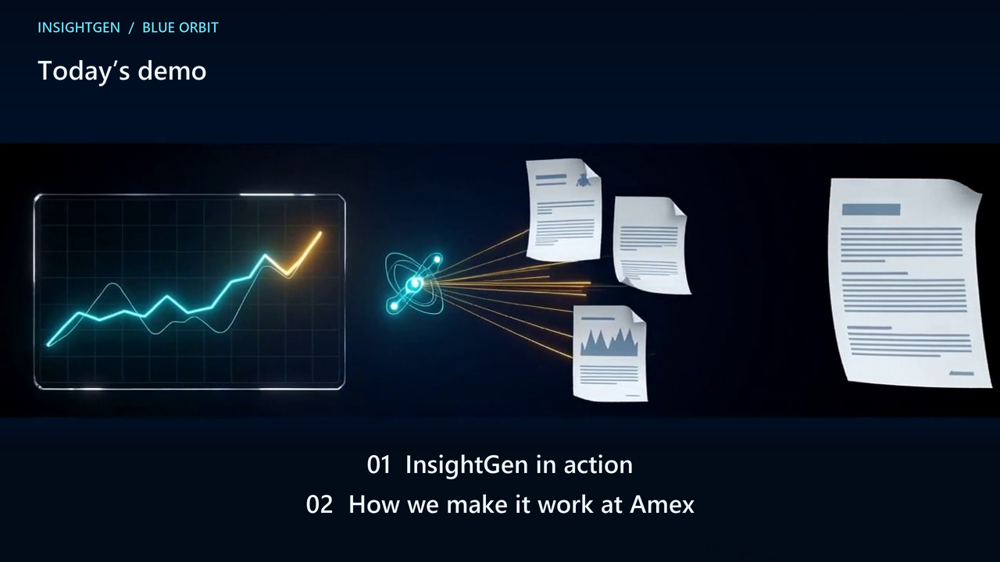

**UNDER THE HOOD · 3s** — The investigation lives on the shared Blue Orbit foundation.

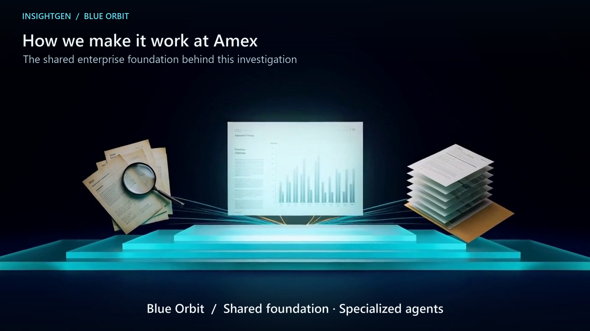

**11s · OUR DIFFERENTIATOR** — Reasoning and tools are connected to business-owned enterprise foundations.

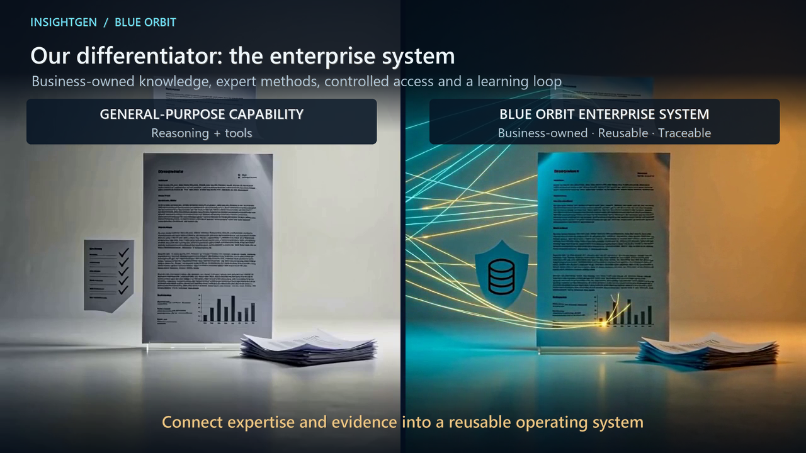

**20s · BUSINESS CURATION** — The business team selects a definition and reviews the policy context.

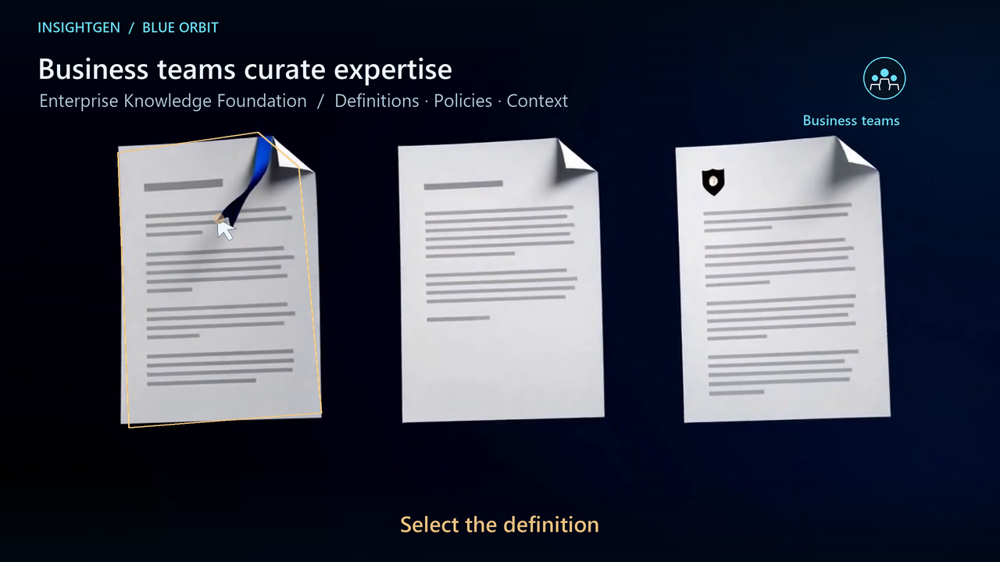

**25.7s · PUBLISH KNOWLEDGE** — The approved C-60 definition retains its source identity.

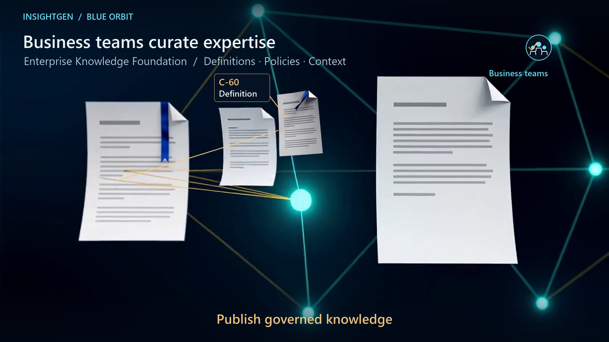

**29s · KNOWLEDGE → METHOD** — The bookmarked source physically grounds analytical primitives.

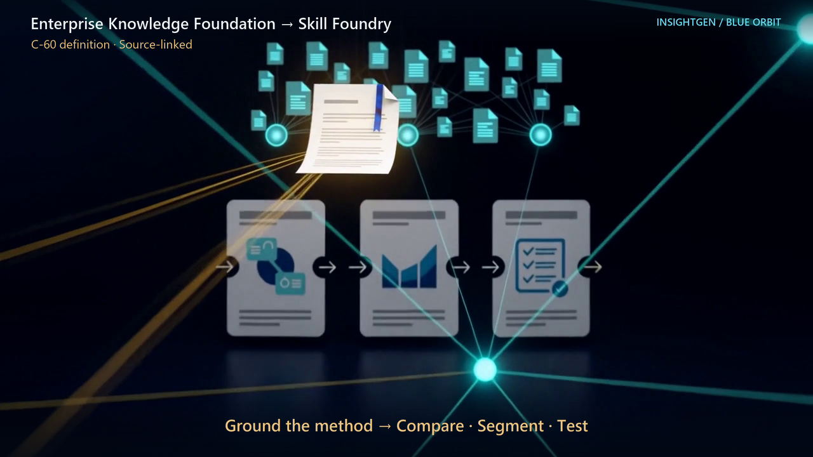

**35s · COMPOSE A SKILL** — Compare, Segment and Test become one reusable method.

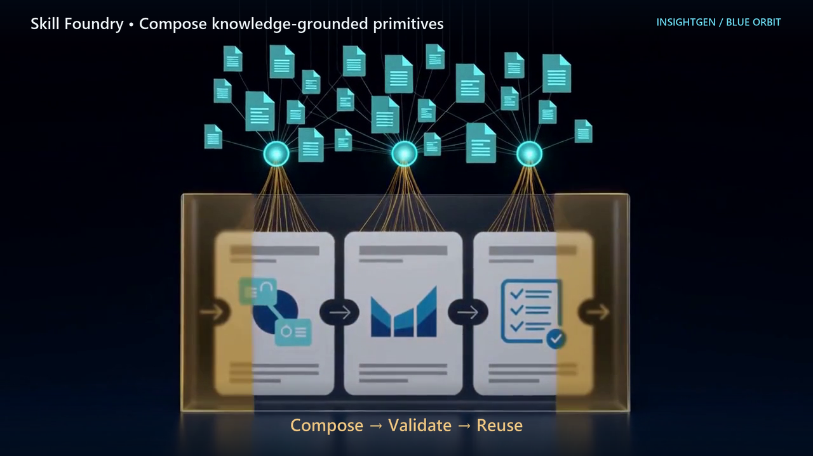

**41.3s · BUSINESS TEAM → RUN** — The team asks InsightGen; the same three-method skill lands in its report.

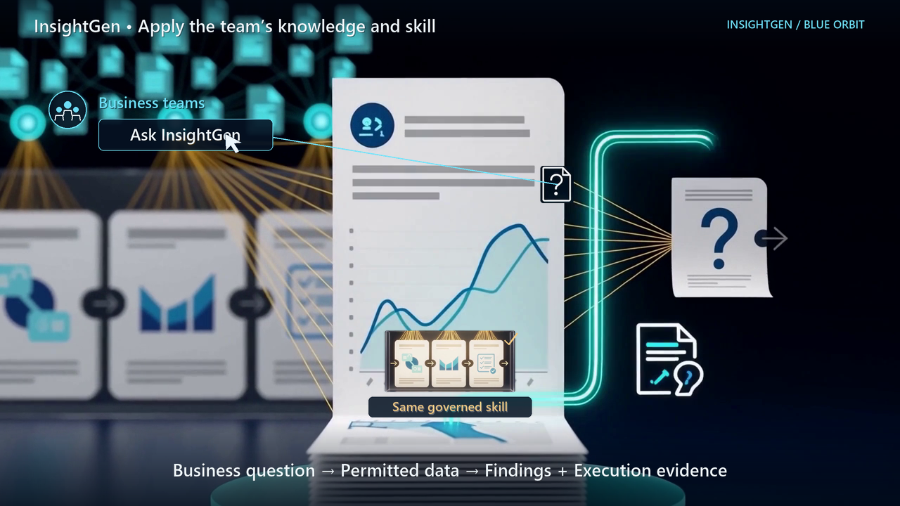

**44s · RUN → EXECUTION TRACE** — The agent run emits the trace that the next component receives.

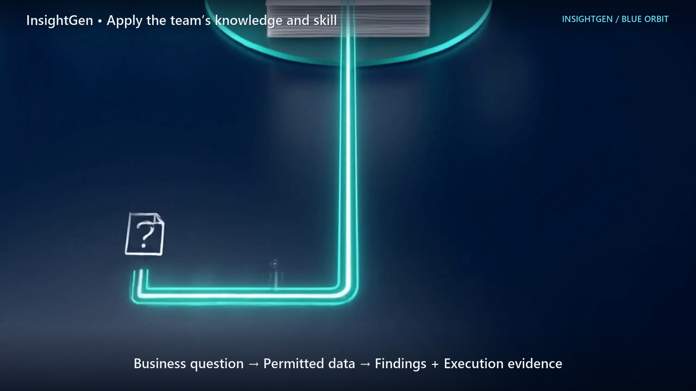

**50s · OBSERVE QUALITY** — AOF captures the run and selects a query-method quality review.

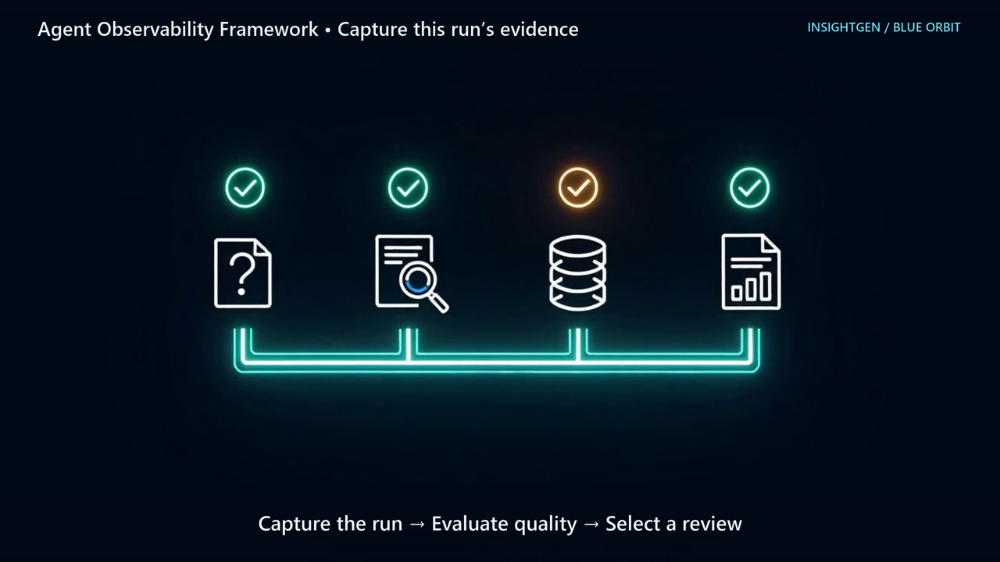

**56s · SAME EVIDENCE → HARNESS** — The same amber query evidence crosses the cut into diagnosis.

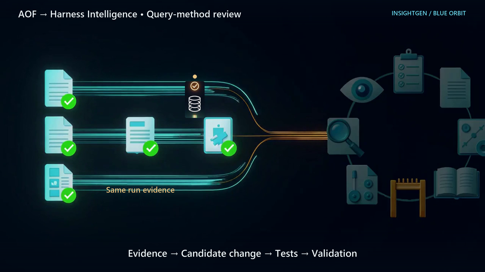

**59s · TEST THE CANDIDATE** — That review informs a change inside the same method folder.

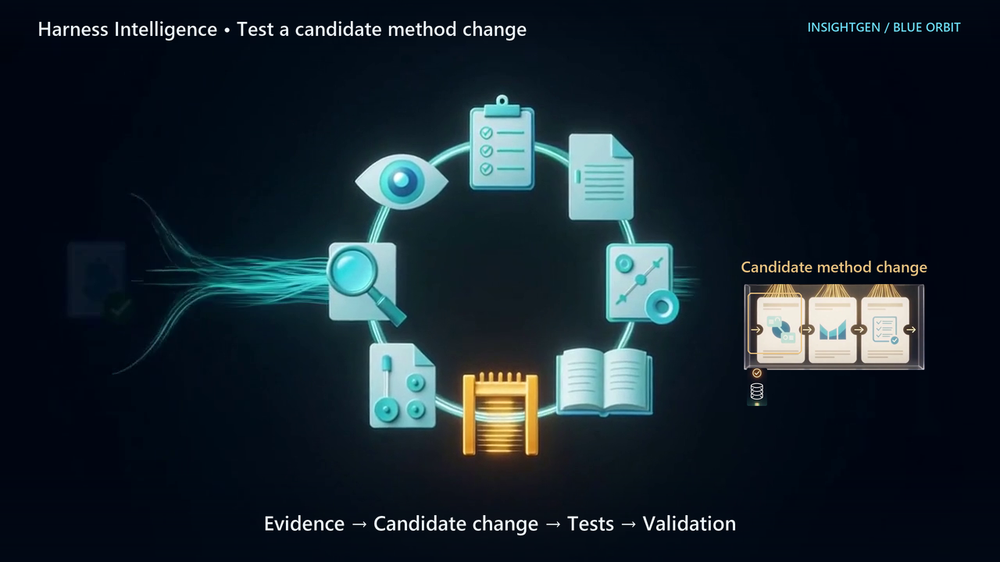

**64.8s · VALIDATE → REUSE** — The validated skill lands in Skill Foundry before its next use.

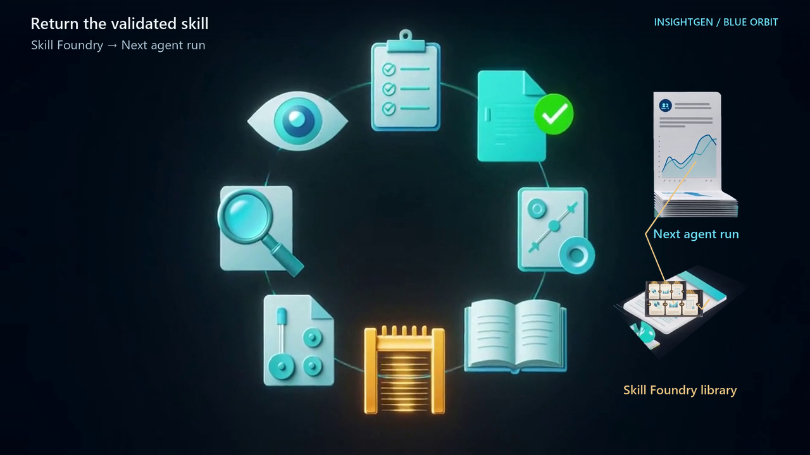

**66.5s · COMPLETE THE LOOP** — A copy enters the next agent workspace, whose input visibly reacts.

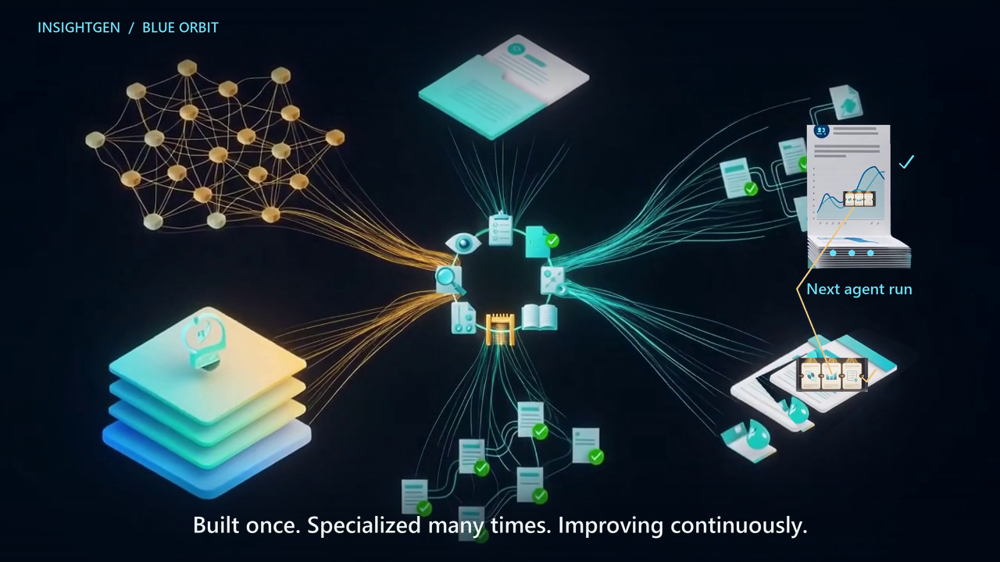
